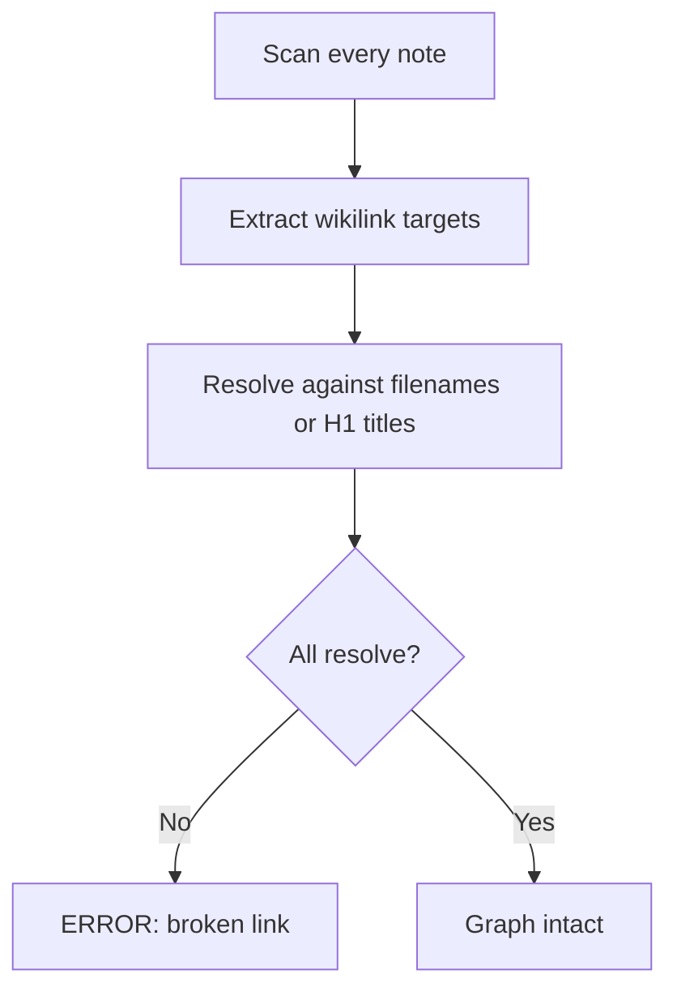

# 04.4.3 — Link checks

**Question this page answers:** *How does the guard find dangling references?*

## The pathway

## Analogy

> **Testing every signpost in a museum before opening the doors** — a sign pointing at nothing is worse than no sign.

## Why / when / who / where

| | |
|---|---|
| **Why** | Broken links destroy the traceability the QMS depends on. |
| **When** | Before every commit, especially after a migration. |
| **Who** | Anyone; CI. |
| **Where** | `scripts/validate-vault.py`. |

## Try it

Run it now: the result should be 0 broken wikilinks.

## What you'll see in Tolaria

- Aliases are stripped before resolution
- Frontmatter links are checked too
- Migration work must re-run this check

## Go deeper

- [[iso-9001-map|Migration source]]
- [[01.4-wikilinks-and-backlinks|How links resolve]]
- [[04.4-validate-and-catch-drift|Parent]]

## Back

[[04.4-validate-and-catch-drift]] — parent page · [[04-monitor]] — tier overview · [[00-start-here]] — hub
