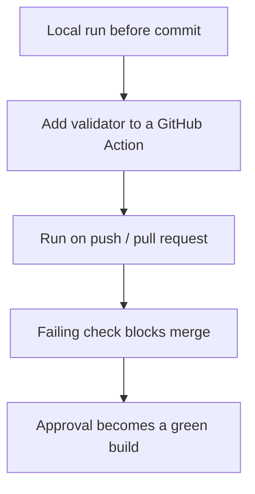

# 04.4.4 — CI next step

**Question this page answers:** *How do I make this guard automatic?*

## The pathway

## Analogy

> **Moving the security guard from the door to the turnstile** — nobody can walk past, even when the manager is on holiday.

## Why / when / who / where

| | |
|---|---|
| **Why** | A check people can skip is a suggestion; a check CI runs is a control. |
| **When** | Once the vault has a Git remote. |
| **Who** | QA manager with a developer. |
| **Where** | `.github/workflows/` (future); `scripts/validate-vault.py`. |

## Try it

Describe what a red build would mean for an `active` SOP without an approver.

## What you'll see in Tolaria

- Not part of this vault-only deliverable
- Keep the script dependency-free
- Same pattern as the source material's docs:build gate

## Go deeper

- [[04.4-validate-and-catch-drift|Parent]]
- [[03.2.3-approving-and-activating|Rule enforced]]
- [[README|Vault README]]

## Back

[[04.4-validate-and-catch-drift]] — parent page · [[04-monitor]] — tier overview · [[00-start-here]] — hub
