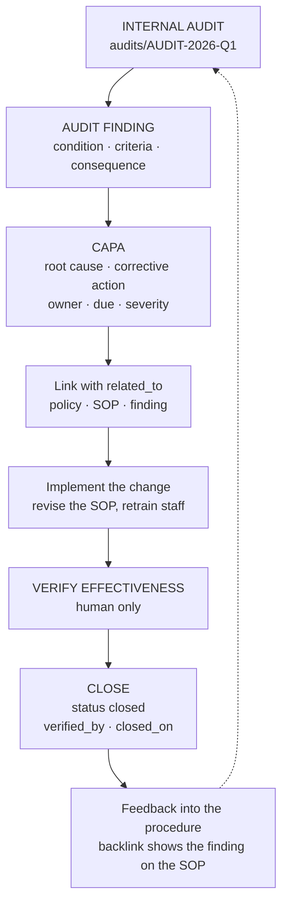

# 05 — Improve: close the loop

**Question this page answers:** *"We found a systemic problem. How is it fixed and proven?"*

## The pathway

## Analogy

> **A family tree for rules.** Open a great-grandparent policy and see every child SOP, record and open finding beneath it. The loop — policy → SOP → practice → problem → fix → policy updated — is what ISO calls *continual improvement*. With bidirectional links it is visible instead of aspirational.

## Why / when / who / where

| | |
|---|---|
| **Why** | An auditor asks "show me continual improvement". A closed, linked CAPA is the answer. |
| **When** | Quarterly internal audits; any repeated or systemic nonconformance. |
| **Who** | QA director audits and verifies; QA engineer owns actions; nobody but a human closes. |
| **Where** | `audits/`, `capa/`, `records/`; views `open-capas.yml`, `nonconformances-open.yml`. |

## Branches from here

- [[05.1-run-an-internal-audit]] — schedule and evidence
- [[05.2-write-a-finding]] — condition, criteria, consequence
- [[05.3-capa-lifecycle]] — root cause to action
- [[05.4-verification-and-closure]] — the human signature

## Go deeper

- [[AUDIT-2026-Q1]] — a worked audit finding
- [[CAPA-2026-002]] — an open CAPA with verification pending
- [[CAPA-2026-001]] — a closed CAPA with human attestation
- [[nc-lifecycle]] — how a nonconformance feeds this loop

## Back

[[00-start-here]] — return to the top-level map.
