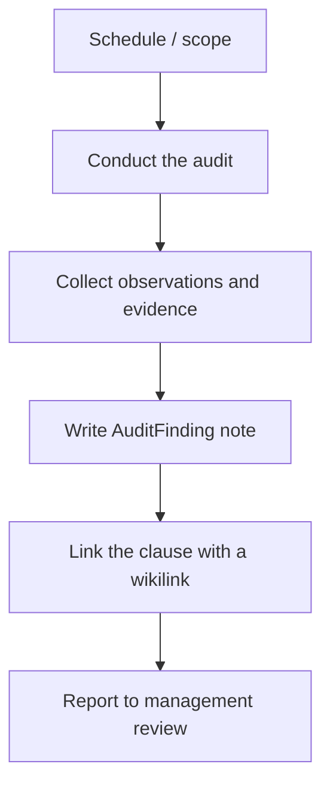

# 05.1 — Run an internal audit

**Question this page answers:** *How does an audit become evidence in the vault?*

## The pathway

## Analogy

> A **health check-up with a written diagnosis**: you do not just say 'you look unwell', you record the symptom, the rule and the risk.

## Why / when / who / where

| | |
|---|---|
| **Why** | An audit without a durable finding disappears into an email. |
| **When** | Quarterly, or before certification. |
| **Who** | QA director audits independently. |
| **Where** | `audits/`; clause `iso2015-9-2`. |

## Try it

Open [[AUDIT-2026-Q1]] and find its condition, criteria and consequence sections.

## What you'll see in Tolaria

- Findings carry severity, owner, due
- The clause link makes the criteria checkable
- The worksheet itself stays outside the vault

## Go deeper

- [[AUDIT-2026-Q1|Worked audit finding]]
- [[iso2015-9-2-Internal-audit|Clause reference]]
- [[05.2-write-a-finding|Next step]]

## Back

[[05-improve]] — parent pathway · [[00-start-here]] — hub
