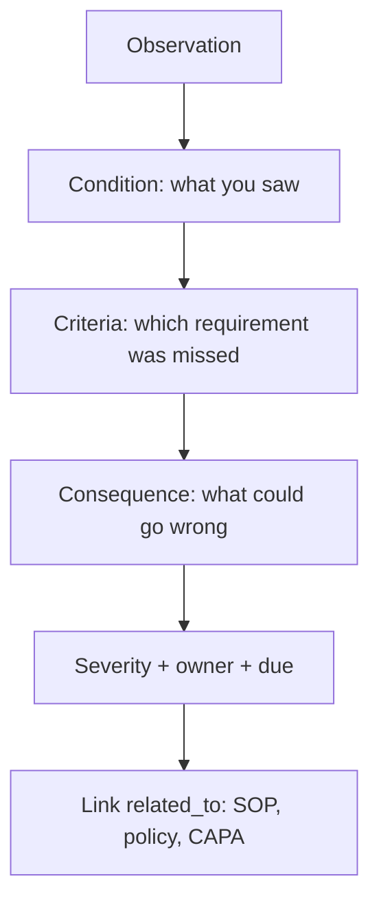

# 05.2 — Write a finding

**Question this page answers:** *What makes a finding useful rather than vague?*

## The pathway

## Analogy

> Like a **doctor's note**: symptom, expected norm, risk if untreated, and who follows up.

## Why / when / who / where

| | |
|---|---|
| **Why** | An auditor needs all four parts; 'housekeeping could be better' is not a finding. |
| **When** | At the moment the observation is made. |
| **Who** | Auditor writes; process owner acknowledges. |
| **Where** | `types/AuditFinding.md`; SOP-QA-002. |

## Try it

Compare [[AUDIT-2026-Q1]] with [[NC-2026-11-19-001]] — one is audit-sourced, one operator-sourced, both typed AuditFinding.

## What you'll see in Tolaria

- tags distinguish audit vs operator
- Clauses are wikilinks, not plain text
- related_to carries the traceability

## Go deeper

- [[AuditFinding|Type document]]
- [[NC-2026-11-19-001|Operator-sourced finding]]
- [[05.3-capa-lifecycle|When to open a CAPA]]

## Back

[[05-improve]] — parent pathway · [[00-start-here]] — hub
