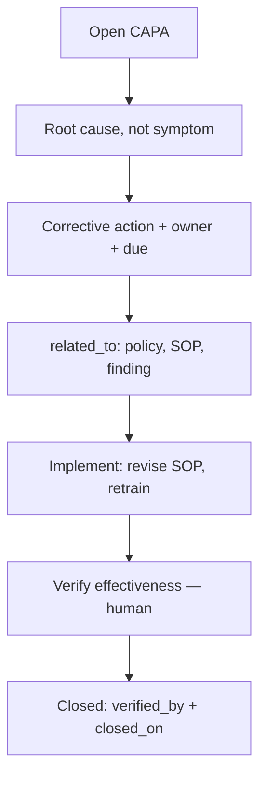

# 05.3 — CAPA lifecycle

**Question this page answers:** *How does a problem become a closed corrective action?*

## The pathway

## Analogy

> **Fix the leaky pipe, not just mop the floor.** A CAPA that only treats the symptom will come back as a repeat finding.

## Why / when / who / where

| | |
|---|---|
| **Why** | Continual improvement is the loop the standard actually tests. |
| **When** | When a cause is systemic or a problem repeats. |
| **Who** | QA engineer owns; QA director verifies. |
| **Where** | `capa/`; view `open-capas.yml`. |

## Try it

Open [[CAPA-2026-002]] and list the three documents it links to.

## What you'll see in Tolaria

- An open CAPA has empty closure fields
- Root cause lives in the body, not in frontmatter
- Only a human may close

## Level 3 branches

- [[05.3.1-raise-a-capa]]
- [[05.3.2-find-the-root-cause]]
- [[05.3.3-implement-the-action]]

## Go deeper

- [[CAPA-2026-002|Open CAPA]]
- [[CAPA-2026-001|Closed CAPA]]
- [[iso2015-10-2-Nonconformity-and-corrective-action|Clause reference]]

## Back

[[05-improve]] — parent pathway · [[00-start-here]] — hub
