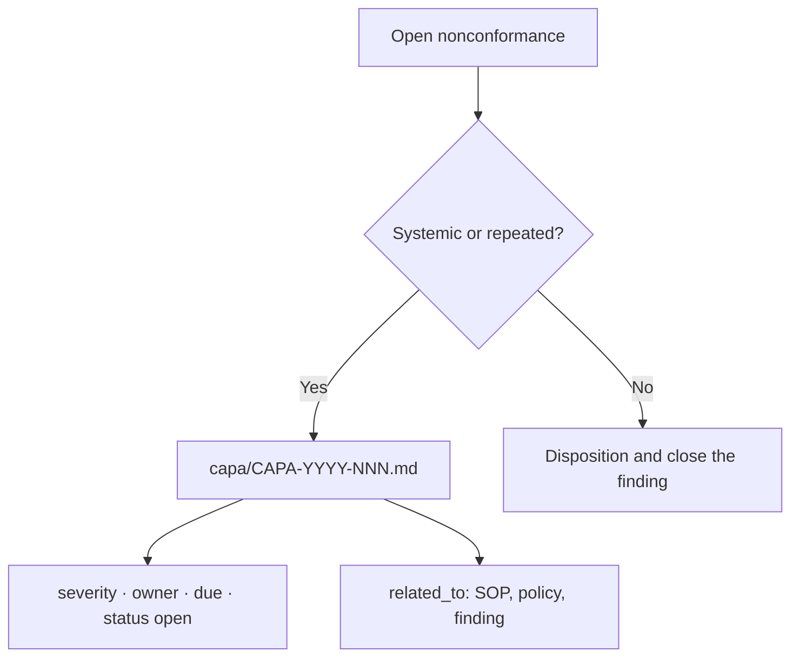

# 05.3.1 — Raise a CAPA

**Question this page answers:** *When does a nonconformance become a CAPA?*

## The pathway

## Analogy

> **Calling the plumber instead of mopping again** — a puddle once is an incident; a puddle every morning is a systemic fault.

## Why / when / who / where

| | |
|---|---|
| **Why** | CAPA is for causes, not events. |
| **When** | When a cause repeats, crosses batches, or could affect released product. |
| **Who** | QA engineer proposes; QA manager approves opening it. |
| **Where** | `capa/`; `types/CAPA.md`. |

## Try it

On [[CAPA-2026-002]], find the finding and SOP it links to.

## What you'll see in Tolaria

- Root cause and action are body prose
- Open CAPAs have empty closure fields
- related_to carries all links

## Go deeper

- [[CAPA-2026-002|Open example]]
- [[NC-2026-11-19-001|Triggering finding]]
- [[05.3-capa-lifecycle|Parent]]

## Back

[[05.3-capa-lifecycle]] — parent page · [[05-improve]] — tier overview · [[00-start-here]] — hub
