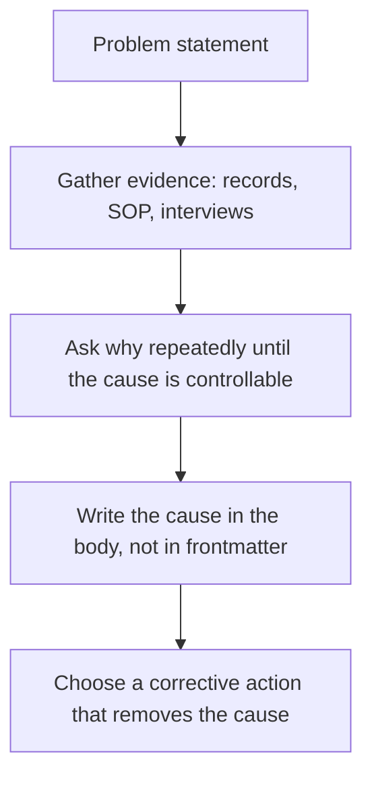

# 05.3.2 — Find the root cause

**Question this page answers:** *How do I avoid fixing only the symptom?*

## The pathway

## Analogy

> **Treating the leaky pipe, not the wet floor** — the mop is the symptom fix; the wrench is the corrective action.

## Why / when / who / where

| | |
|---|---|
| **Why** | An auditor will test whether the action addresses the stated cause. |
| **When** | During CAPA investigation, before implementing anything. |
| **Who** | QA engineer; process owner consulted. |
| **Where** | `capa/CAPA-*.md`, body section Root cause. |

## Try it

Read the root cause on [[CAPA-2026-002]] and identify the symptom it explains.

## What you'll see in Tolaria

- Root cause is narrative, so it lives in the body
- Evidence stays linked via related_to
- The cause must be something you can change

## Go deeper

- [[CAPA-2026-002|Root cause example]]
- [[AUDIT-2026-Q1|Evidence source]]
- [[05.3-capa-lifecycle|Parent]]

## Back

[[05.3-capa-lifecycle]] — parent page · [[05-improve]] — tier overview · [[00-start-here]] — hub
