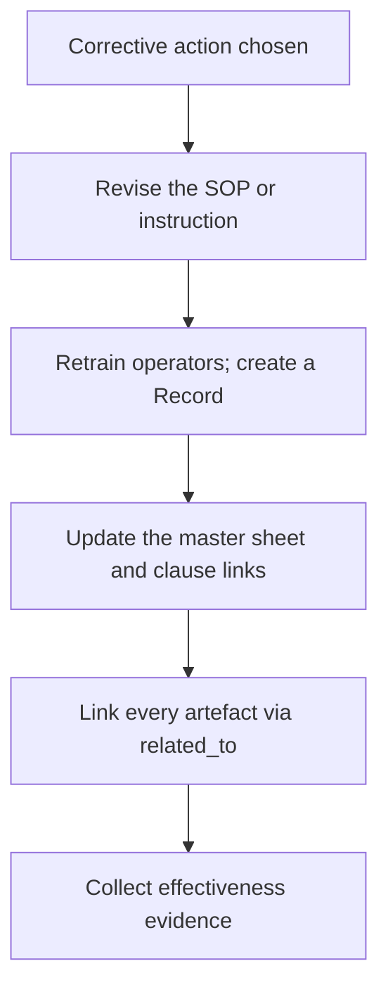

# 05.3.3 — Implement the action

**Question this page answers:** *How does a CAPA change the QMS itself?*

## The pathway

## Analogy

> **Renovating the kitchen, then cooking a meal to test it** — the action is the renovation; the test meal is the evidence it worked.

## Why / when / who / where

| | |
|---|---|
| **Why** | A CAPA that does not change a document or behaviour is paperwork. |
| **When** | After root-cause agreement, before verification. |
| **Who** | QA engineer implements; QA manager authorises. |
| **Where** | `procedures/`, `records/`, `capa/`. |

## Try it

Trace the chain from [[CAPA-2026-002]] to the SOP revision and training record.

## What you'll see in Tolaria

- One action may touch several documents
- Records prove the training happened
- Keep the CAPA open until verified

## Go deeper

- [[SOP-QA-001|Revised SOP]]
- [[TRAIN-REC-2026-07|Training evidence]]
- [[05.4-verification-and-closure|Next step]]

## Back

[[05.3-capa-lifecycle]] — parent page · [[05-improve]] — tier overview · [[00-start-here]] — hub
