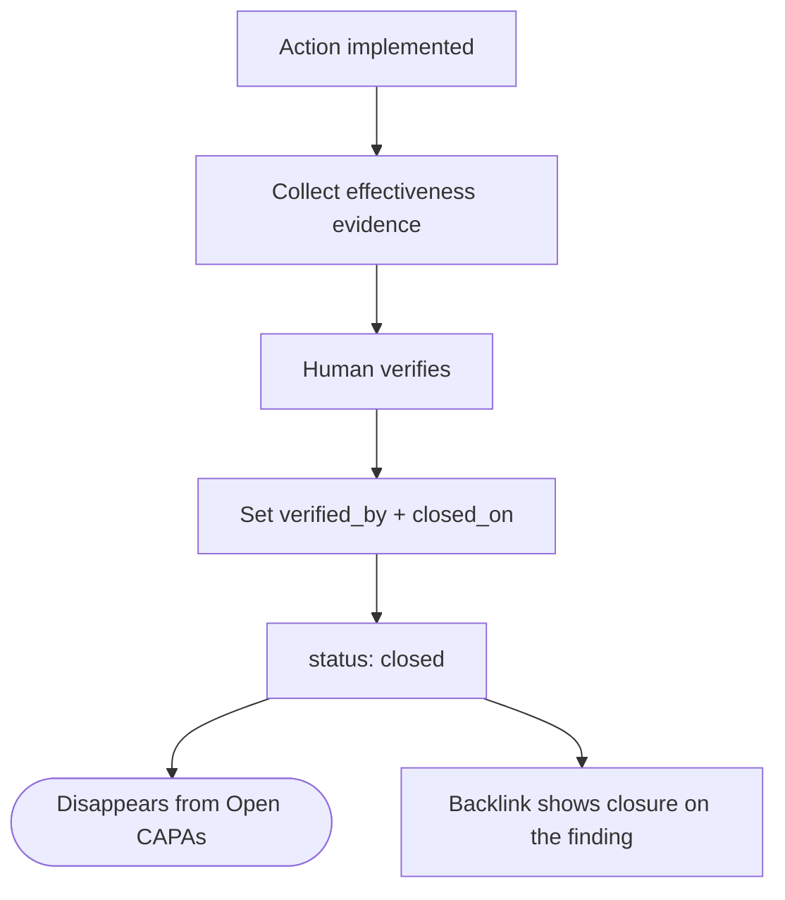

# 05.4 — Verification and closure

**Question this page answers:** *What is the last step before a CAPA can be closed?*

## The pathway

## Analogy

> The **second signature that makes the first one meaningful** — the person who verifies is not the person who fixed it.

## Why / when / who / where

| | |
|---|---|
| **Why** | Closure without independent verification is a finding waiting to happen. |
| **When** | After the agreed verification period. |
| **Who** | QA director only. |
| **Where** | `capa/`; `AGENTS.md` rule 4. |

## Try it

Find the `closed_on` date on [[CAPA-2026-001]] and who verified it.

## What you'll see in Tolaria

- Agents may never set closure fields
- Closed CAPAs stay in All nonconformances
- Git records who made the change

## Go deeper

- [[CAPA-2026-001|Verified and closed example]]
- [[qa-director|Verifier role]]
- [[07.1-roles-and-people|Who may sign]]

## Back

[[05-improve]] — parent pathway · [[00-start-here]] — hub
