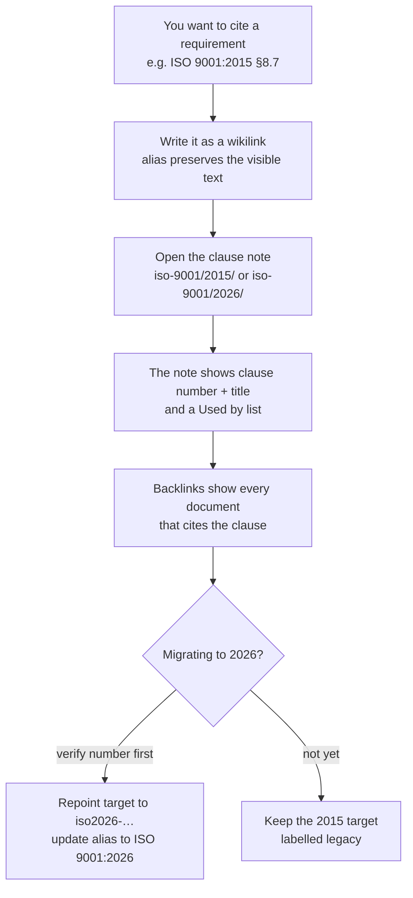

# 06 — Align: ISO 9001 clause references

**Question this page answers:** *"Where does this requirement come from, and which edition am I citing?"*

## The pathway

## Analogy

> **A road map with mile markers.** The marker is not the road — it is a signpost that lets everyone agree where they are. The clause notes are signposts, not a copy of the standard. The real requirement lives in the purchased ISO document; the vault just points at it consistently.

## Why / when / who / where

| | |
|---|---|
| **Why** | "Show me which clause requires this" must be answerable in one click. |
| **When** | Writing a procedure, mapping an obligation, or preparing for a migration audit. |
| **Who** | QA manager owns mappings; anyone may follow them. |
| **Where** | `iso-9001/2015/` (legacy citations), `iso-9001/2026/` (current top-level structure). |

> ISO 9001:2026 is current since 2026-09-06; 2015 was withdrawn 2026-09-16 with a three-year transition. 2026 subclause numbers are **not verified** here — check the standard before repointing a link.

## Branches from here

- [[06.1-iso-9001-2026]] — current edition
- [[06.2-legacy-2015-clause-notes]] — existing citations
- [[06.3-migrate-a-clause-link]] — safe migration

## Go deeper

- [[iso-9001-map]] — full edition map and linking convention
- [[iso2015-7-5-Documented-information|§7.5 documented information]]
- [[raci-obligations.sheet]] — source clauses in the obligations matrix

## Back

[[00-start-here]] — return to the top-level map.
