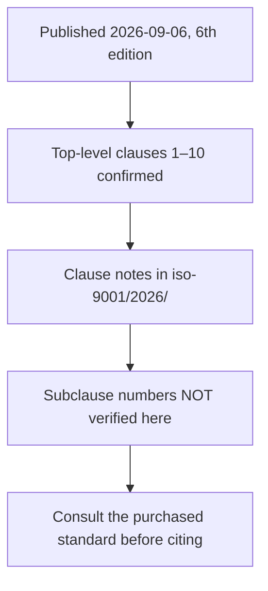

# 06.1 — ISO 9001:2026

**Question this page answers:** *Which edition is current, and what can I safely cite?*

## The pathway

## Analogy

> A **new road map of the same city**: the main roads are where you remember them, but the side-street numbers need checking before you give directions.

## Why / when / who / where

| | |
|---|---|
| **Why** | Citing a withdrawn edition or a guessed subclause is worse than citing no clause. |
| **When** | When mapping a new requirement or planning migration. |
| **Who** | QA manager owns mappings. |
| **Where** | `iso-9001/2026/`; ISO's own standard page. |

## Try it

Open `iso-9001/iso-9001-map.md` and list the 10 top-level clauses.

## What you'll see in Tolaria

- 2026 keeps the high-level structure
- 6.3 expanded from four to seven factors
- 2015 is withdrawn with a 3-year transition

## Go deeper

- [[iso-9001-map|Edition map]]
- [[iso2026-8-Operation|Current top-level clause]]
- [[06.3-migrate-a-clause-link|How to repoint links]]

## Back

[[06-align]] — parent pathway · [[00-start-here]] — hub
