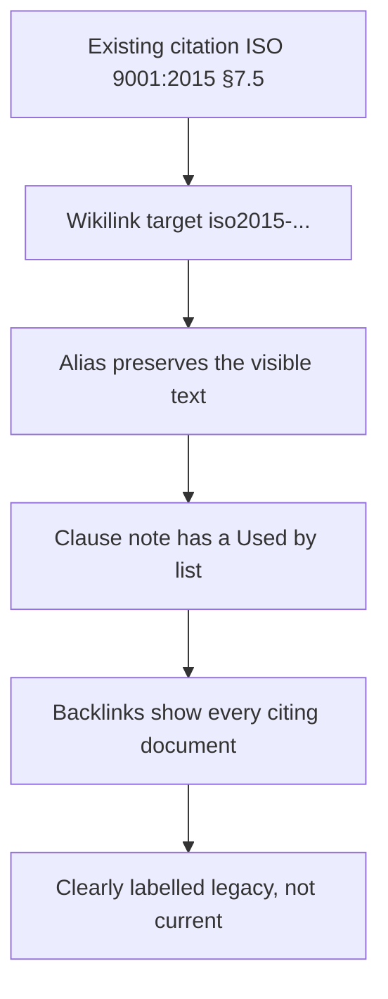

# 06.2 — Legacy 2015 clause notes

**Question this page answers:** *Why do the existing citations still point at 2015?*

## The pathway

## Analogy

> An **old map still pinned on the wall**, clearly stamped 'superseded' — useful while everyone is still using the old street names.

## Why / when / who / where

| | |
|---|---|
| **Why** | Honest labelling beats silently rewriting history. |
| **When** | When reading or auditing existing documents during transition. |
| **Who** | Everyone reading the current vault. |
| **Where** | `iso-9001/2015/`; `iso-9001-map.md`. |

## Try it

Open [[iso2015-7-5-Documented-information]] and follow one name in its Used by list.

## What you'll see in Tolaria

- Alias keeps the sheet readable
- Edition is encoded in the target
- Clause notes contain no normative text

## Go deeper

- [[iso-9001-map|Map and convention]]
- [[raci-obligations.sheet|Live legacy citations]]
- [[POL-QUAL-002|Policy citing 7.5.2 and 7.5.3]]

## Back

[[06-align]] — parent pathway · [[00-start-here]] — hub
