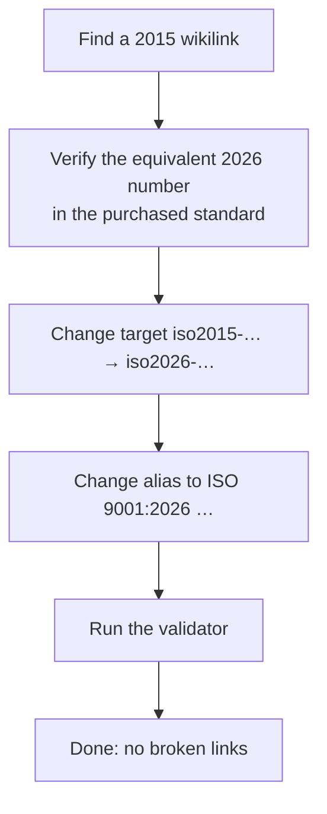

# 06.3 — Migrate a clause link

**Question this page answers:** *How do I repoint a citation to 2026 without breaking it?*

## The pathway

## Analogy

> **Changing the address on a letter while keeping the recipient** — the reader still finds the same idea, under the current system.

## Why / when / who / where

| | |
|---|---|
| **Why** | A mechanical find-and-replace can silently change meaning; verify first. |
| **When** | During the 3-year transition, clause by clause. |
| **Who** | QA manager, with the standard in hand. |
| **Where** | `iso-9001/` folders; `scripts/validate-vault.py`. |

## Try it

Pick one citation, write the verification step before changing anything.

## What you'll see in Tolaria

- Never guess a 2026 subclause number
- The validator catches broken targets
- Keep a note of which clauses were migrated

## Go deeper

- [[iso-9001-map|Migration guidance]]
- [[POL-QUAL-001|Document with clause citations]]
- [[04.4-validate-and-catch-drift|Check after migration]]

## Back

[[06-align]] — parent pathway · [[00-start-here]] — hub
