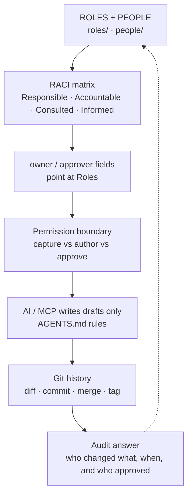

# 07 — Govern: who may do what

**Question this page answers:** *"Who owns this, who may approve it, and how do we prove it?"*

## The pathway

## Analogy

> **The reception desk and the approver.** The reception desk can take your paperwork but cannot approve your application — a different badge, different permissions. Likewise, a capture-only AI connection may drop notes into Inbox but may not publish a procedure. Git is the notary's log that records every hand-off.

## Why / when / who / where

| | |
|---|---|
| **Why** | Tolaria has no granular access control inside one vault. The discipline lives in process and in the Git boundary. |
| **When** | Assigning a new document, onboarding a person, granting AI/MCP access, or answering an auditor. |
| **Who** | QA director is accountable; QA manager approves procedures; QA engineer executes. |
| **Where** | `roles/`, `people/`, `raci-obligations.sheet`, `AGENTS.md`, Git history. |

## Branches from here

- [[07.1-roles-and-people]] — stable roles, changing people
- [[07.2-raci-and-obligations]] — who owes what
- [[07.3-permissions-and-ai-mcp]] — badges and boundaries
- [[07.4-git-as-audit-trail]] — proof of change

## Go deeper

- [[qa-director]] — accountable for the QMS and CAPA verification
- [[qa-manager]] — document approval and register ownership
- [[raci-obligations.sheet]] — the full rights-and-obligations matrix
- [[sop-lifecycle]] — where the human approval gate sits

## Back

[[00-start-here]] — return to the top-level map.
