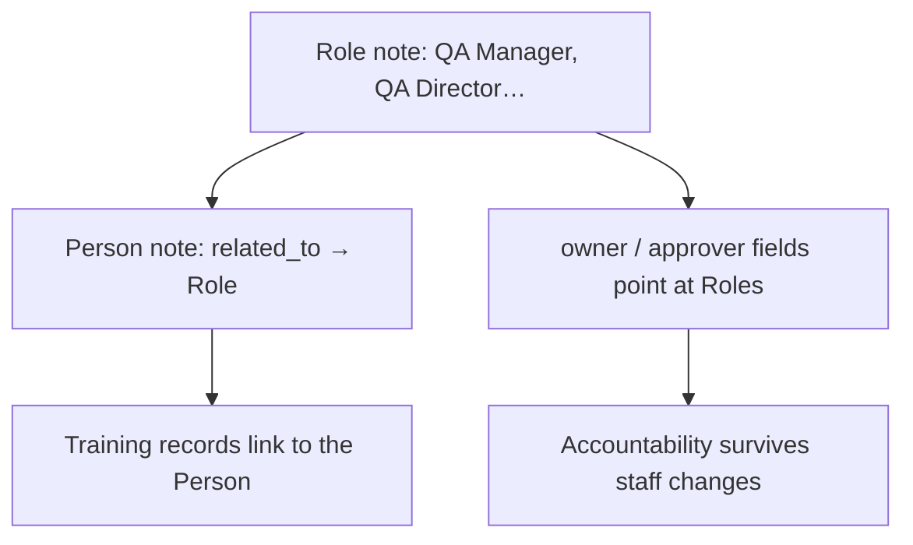

# 07.1 — Roles and people

**Question this page answers:** *Who is accountable, and who currently holds the role?*

## The pathway

## Analogy

> **Job title versus the person sitting in the chair.** The chair stays; the person changes. Point documents at the chair.

## Why / when / who / where

| | |
|---|---|
| **Why** | Linking approvals to roles prevents a rewrite of every document when staff change. |
| **When** | When assigning a document or onboarding a person. |
| **Who** | QA director maintains roles; HR/QA maintains people. |
| **Where** | `roles/`, `people/`. |

## Try it

Open [[jane-doe]] and follow `related_to` to [[qa-engineer]].

## What you'll see in Tolaria

- Roles are the stable target
- Person notes hold contact and training
- related_to carries the link after simplification

## Go deeper

- [[qa-director|Accountable role]]
- [[qa-manager|Approver role]]
- [[jane-doe|Person holding a role]]
- [[07.2-raci-and-obligations|Next layer]]

## Back

[[07-govern]] — parent pathway · [[00-start-here]] — hub
