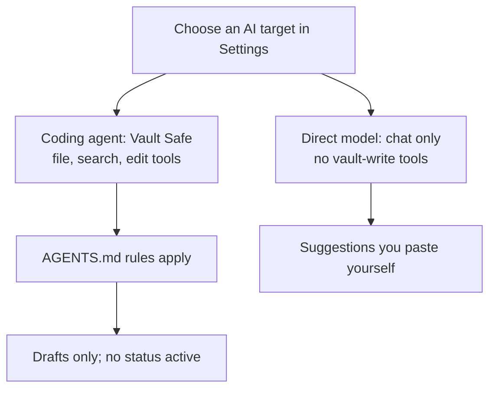

# 07.3 — Permissions and AI/MCP

**Question this page answers:** *What can an assistant be allowed to do?*

## The pathway

## Analogy

> **Reception desk badge versus approver's badge.** A capture-only connection can take paperwork; it cannot approve it.

## Why / when / who / where

| | |
|---|---|
| **Why** | Write access to controlled documents is exactly the thing that creates nonconformities. |
| **When** | When configuring an assistant or an MCP connection. |
| **Who** | QA manager configures; QA director approves the boundary. |
| **Where** | Settings → AI; `AGENTS.md`; MCP setup dialog. |

## Try it

Read AGENTS.md and name the rule that forbids an agent setting `status: active`.

## What you'll see in Tolaria

- Vault Safe limits tools
- Power User allows shell — avoid for QMS
- Commit prefix chore(ai): gives provenance

## Level 3 branches

- [[07.3.1-choosing-a-target]]
- [[07.3.2-vault-safe-vs-power-user]]
- [[07.3.3-agents-rules]]
- [[07.3.4-mcp-setup]]

## Go deeper

- [[ai-sop-draft-prompt|Drafting prompt]]
- [[sop-lifecycle|Human approval gate]]
- [[03.5-templates-and-ai-drafting|Drafting pathway]]

## Back

[[07-govern]] — parent pathway · [[00-start-here]] — hub
