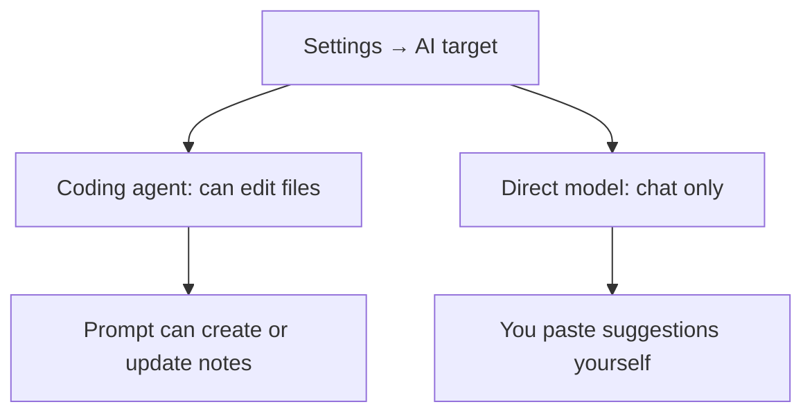

# 07.3.1 — Choosing a target

**Question this page answers:** *Which AI mode am I actually using?*

## The pathway

## Analogy

> **A contractor with a key versus a consultant with an opinion** — one can enter the building, the other can only advise.

## Why / when / who / where

| | |
|---|---|
| **Why** | Permission boundaries determine whether an assistant can write at all. |
| **When** | Before any AI-assisted QMS work. |
| **Who** | QA manager configures. |
| **Where** | Settings → AI. |

## Try it

State why a direct model cannot draft directly into the vault.

## What you'll see in Tolaria

- Coding agents include OpenCode, Claude Code, Codex
- Direct models include Ollama and API providers
- Model choice is remembered per agent

## Go deeper

- [[ai-sop-draft-prompt|Prompt to paste]]
- [[03.5.2-panel-or-inline|Where to prompt]]
- [[07.3-permissions-and-ai-mcp|Parent]]

## Back

[[07.3-permissions-and-ai-mcp]] — parent page · [[07-govern]] — tier overview · [[00-start-here]] — hub
