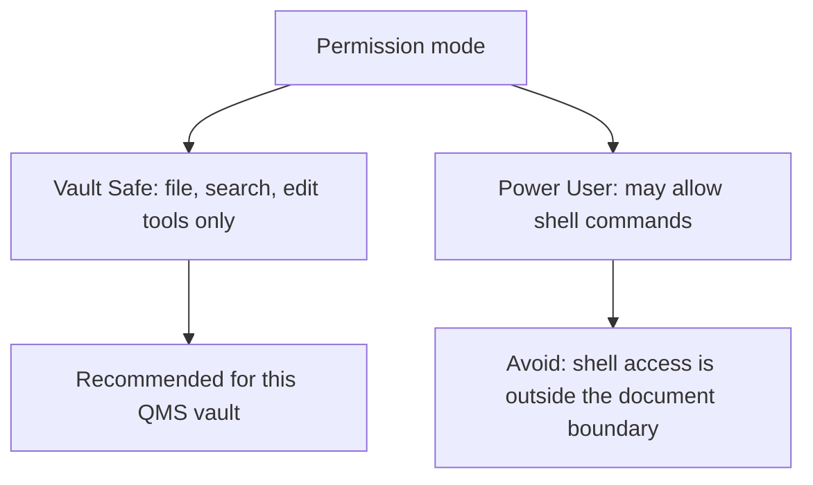

# 07.3.2 — Vault Safe vs Power User

**Question this page answers:** *How much access should an agent get?*

## The pathway

## Analogy

> **Giving the intern a desk key, not the master key** — they can reach the filing cabinet, not the building's fuse box.

## Why / when / who / where

| | |
|---|---|
| **Why** | The smallest sufficient permission is the safest for controlled documents. |
| **When** | When configuring any coding agent on this vault. |
| **Who** | QA manager; QA director approves. |
| **Where** | Settings → AI → Permission mode. |

## Try it

Explain why Power User is a poor fit for a QMS demo.

## What you'll see in Tolaria

- Vault Safe still allows file edits
- Power User is agent-dependent
- Git provides rollback if an edit goes wrong

## Go deeper

- `AGENTS.md` — Agent rules
- [[03.5.4-reviewing-ai-drafts|Review step]]
- [[07.3-permissions-and-ai-mcp|Parent]]

## Back

[[07.3-permissions-and-ai-mcp]] — parent page · [[07-govern]] — tier overview · [[00-start-here]] — hub
