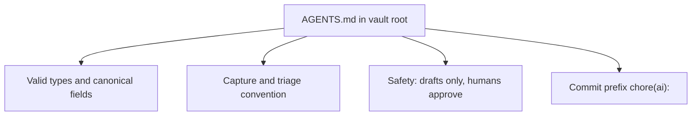

# 07.3.3 — AGENTS rules

**Question this page answers:** *How does the vault instruct an agent?*

## The pathway

## Analogy

> **The employee handbook handed to every new contractor** — same rules, no matter which assistant shows up.

## Why / when / who / where

| | |
|---|---|
| **Why** | Agent behaviour must be explicit, not assumed. |
| **When** | Whenever an agent works in the vault. |
| **Who** | Agent reads it automatically; QA manager maintains it. |
| **Where** | Vault root, `AGENTS.md`. |

## Try it

Name the rule that forbids setting `status: active`.

## What you'll see in Tolaria

- Canonical file for agent guidance
- CLAUDE.md is a compatibility shim in Tolaria's own samples
- Rules are plain Markdown, version-controlled

## Go deeper

- `AGENTS.md` — Guidance file
- [[01.2-types-and-taxonomy|Taxonomy source]]
- [[07.3-permissions-and-ai-mcp|Parent]]

## Back

[[07.3-permissions-and-ai-mcp]] — parent page · [[07-govern]] — tier overview · [[00-start-here]] — hub
