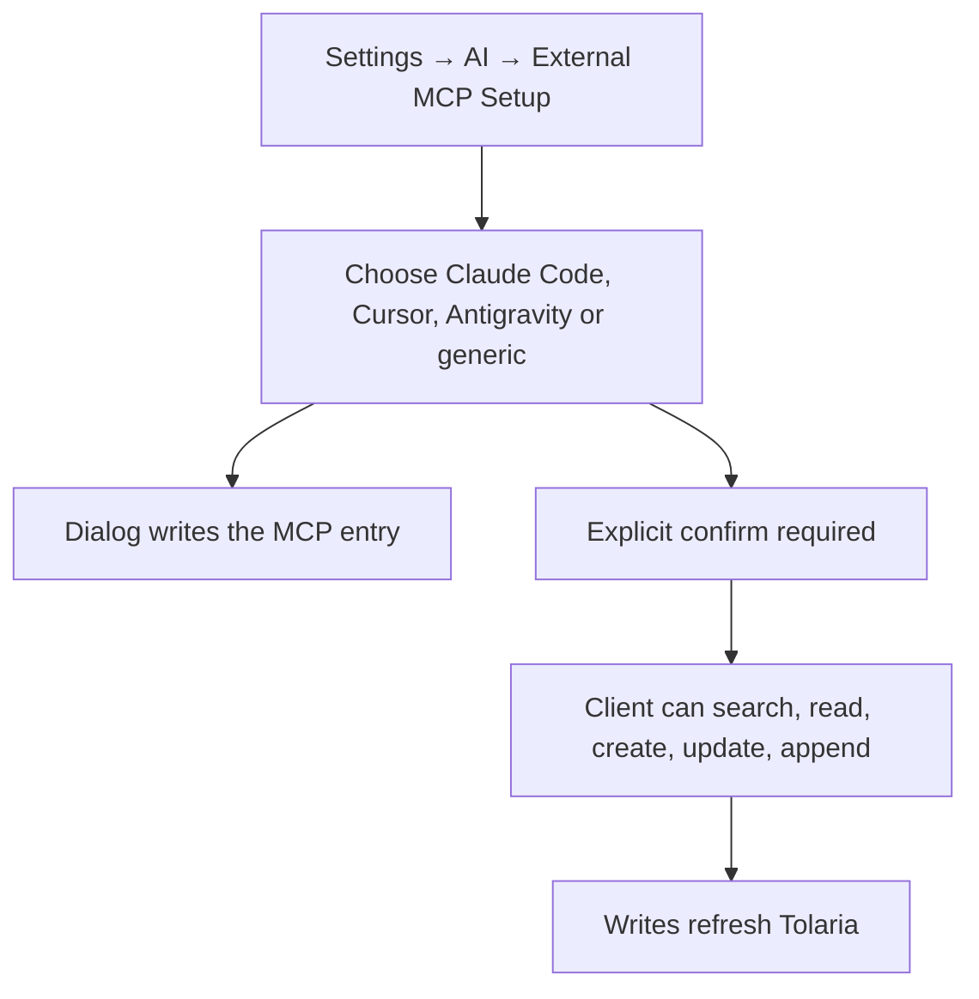

# 07.3.4 — MCP setup

**Question this page answers:** *What happens when I connect an external client?*

## The pathway

## Analogy

> **Issuing a visitor badge that only opens the reading room** — you decide the doors, and the log records the visit.

## Why / when / who / where

| | |
|---|---|
| **Why** | MCP is explicit: closing the dialog must not silently change a third-party config. |
| **When** | When using an outside assistant with the vault. |
| **Who** | QA manager; QA director approves write access. |
| **Where** | Settings → AI; external client config file. |

## Try it

Describe the difference between update_note and append_note.

## What you'll see in Tolaria

- update_note supports a modification-time guard
- Start with read-only tools
- Vet third-party servers before granting writes

## Go deeper

- `AGENTS.md` — Rules the client should follow
- [[03.5.3-external-mcp|Setup pathway]]
- [[07.3-permissions-and-ai-mcp|Parent]]

## Back

[[07.3-permissions-and-ai-mcp]] — parent page · [[07-govern]] — tier overview · [[00-start-here]] — hub
