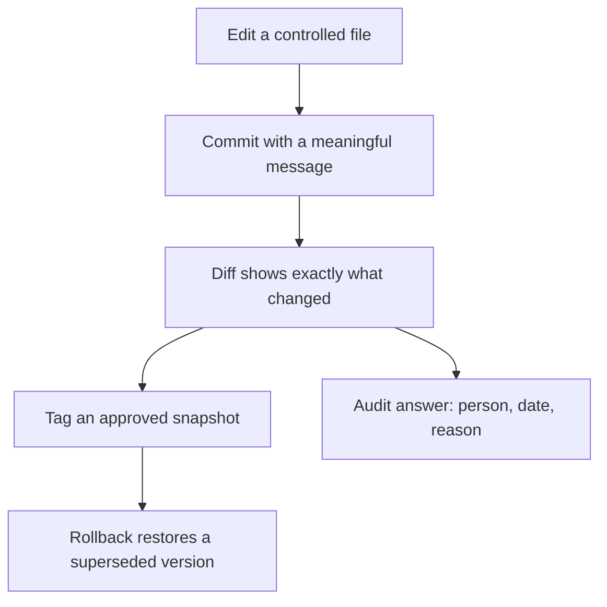

# 07.4 — Git as audit trail

**Question this page answers:** *How do I answer 'who changed this, and when?'*

## The pathway

## Analogy

> A **notarised filing cabinet with a tamper-evident log**. Word's `final_v2_REAL_final(2).docx` is a shoebox by comparison.

## Why / when / who / where

| | |
|---|---|
| **Why** | Git proves *what changed*; the human approval step proves *who approved it*. Together they answer the auditor. |
| **When** | Every change; audit preparation; dispute resolution. |
| **Who** | Anyone with folder access; QA director reviews history. |
| **Where** | Tolaria's Git panel; command line for tags. |

## Try it

Look at a document's history and find the rev 3 draft line in [[SOP-QA-002]].

## What you'll see in Tolaria

- Commit messages are part of the record
- Tags mark approved snapshots
- Git alone is not e-signature

## Go deeper

- [[SOP-QA-002|Document with revision history]]
- [[03.4-revisions-and-git|Versioning rules]]
- [[sop-lifecycle|Merge as approval event]]

## Back

[[07-govern]] — parent pathway · [[00-start-here]] — hub
