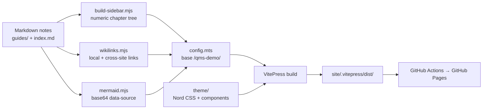

# Development guide — QMS_demo

This repository is one half of a two-site demo. It publishes the **guides**; its counterpart `qms-controls` publishes every other folder. The two are independent: separate repos, configs, workflows and deployments.

## Architecture at a glance



## Repository map

| Path | Purpose |
|---|---|
| `vault/` | The folder opened in Tolaria: `guides/`, `index.md` and the docs below |
| `vault/guides/` | 71 published onboarding pages (`00-start-here`, 7 tiers, branches) |
| `index.md` | Site homepage |
| `site/package.json`, `package-lock.json` | VitePress + Mermaid dependencies and scripts |
| `site/.vitepress/config.mts` | Title, base, nav, `srcDir: '../vault'`, derived `srcExclude`, head script |
| `site/.vitepress/publish-scope.mjs` | **Single source of truth** for published folders + `REMOTE_BASE` |
| `site/.vitepress/wikilinks.mjs` | Converts double-bracket links; local, remote and "not published" cases |
| `site/.vitepress/mermaid.mjs` | Converts mermaid fences into renderable containers |
| `site/.vitepress/build-sidebar.mjs` | Generates `sidebar.json` from numeric filename prefixes |
| `site/.vitepress/remote-manifest.json` | Guide stems from the *other* site (in this repo: control pages) |
| `site/.vitepress/prepare-modules.mjs` | Creates a repo-root `node_modules` symlink (outside the vault) |
| `site/.vitepress/theme/` | Nord CSS and Vue components |
| `.github/workflows/deploy.yml` | Build and deploy to GitHub Pages |
| `scripts/validate-vault.py` | Document-control validator (doc IDs, revisions, register drift) |
| `scripts/validate-wikilinks.py` | Frontmatter, view and wikilink checker |

## Data model (short version)

- A note's type comes from `type:` frontmatter, not its folder. Type definitions are notes in `types/`.
- `doc_id` is permanent identity; `revision` is the edition of one document.
- Only `type`, `status` and `tags` drive saved views. Keep frontmatter minimal.
- Use one relationship field, `related_to`, except `implements` for the policy link.
- Wikilinks resolve by filename stem or H1 title, never by path.
- Full rules are in `AGENTS.md`.

## Build pipeline

1. `npm run docs:prepare` runs `prepare-modules.mjs` (symlink at the **repository root**, never inside `vault/`) and `build-sidebar.mjs`.
2. `config.mts` derives `srcExclude` from `publish-scope.mjs`: everything except `guides/` and `index.md` is skipped.
3. The markdown config installs the wikilink plugin and the Mermaid plugin.
4. VitePress renders pages into `site/.vitepress/dist/`.
5. GitHub Actions uploads that folder to GitHub Pages.

## Theme components and slots

`theme/index.js` extends VitePress's default theme and fills these slots:

| Slot | Component | Job |
|---|---|---|
| `layout-top` | `MermaidMount.vue` | Render diagrams, handle theme changes and navigation, save reading position |
| `doc-before` | `ChapterBanner.vue` | Chapter banner + homepage "continue reading" card |
| `doc-after` | `ChapterNav.vue` | Previous / next chapter footer |
| `sidebar-nav-before` | `SidebarControls.vue` | Expand all / collapse all |
| `nav-bar-content-before` | `SidebarToggle.vue` | Hide / show navigation |

`custom.css` sets Nord variables for both appearances, compact sidebar typography, card styling only for rendered diagrams, the full-screen diagram overlay, and cross-site link markers.

## Commands

```sh
# from the repo root
python3 scripts/validate-vault.py
python3 scripts/validate-wikilinks.py

# from site/
npm ci
npm run docs:dev       # local preview
npm run docs:build     # production build
```

## Deployment

- Remote: `git@github.com:jetra360/qms-demo.git` (SSH key registered on GitHub).
- Push to `main` triggers *Build & Deploy QMS Site*.
- GitHub → Settings → Pages → Build and deployment → Source: **GitHub Actions**.
- Live: `https://jetra360.github.io/qms-demo/`.
- The site is static; it stays online when this computer is off. Local dev/preview servers are only for testing.

## Verification checklist

- [ ] Both validators pass (the four frontmatter notices are intentional).
- [ ] `npm run docs:build` completes without error.
- [ ] Sidebar shows one *Guides* group with 7 chapters; chapters are bigger than sections.
- [ ] Expand all / collapse all and hide/show navigation work.
- [ ] Theme switch works and diagrams redraw.
- [ ] Every diagram has an **Expand overview** button; overlay zoom and close work.
- [ ] A link to a control note opens `qms-controls` with a "↗" marker.
- [ ] Workflow is green and the live URL returns 200.

## Common changes

| Task | Where |
|---|---|
| Publish a different folder | `publish-scope.mjs` → `PUBLISHED_FOLDERS` |
| Change site name / URL | `config.mts` (`title`, `base`) and the GitHub repo name |
| Add or rename a note | Regenerate `remote-manifest.json` in **both** repos |
| Change colours | `theme/custom.css` variables |
| Add a nav item | `config.mts` → `themeConfig.nav` |
| Add a diagram | Fence it as `mermaid`; add `wide` after the language for a large overview |

## Pitfalls — do not reintroduce

- Never alias `vue` in `config.mts`: two Vue instances cause `shallowRef` hydration failure and dead controls.
- Never hand-edit `sidebar.json`; it is generated.
- VitePress collapses literal newlines in raw HTML — Mermaid source must stay in `data-source`.
- VitePress scopes `.VPSidebar`; global padding overrides need `!important` on left/right/bottom only.
- `nav-bar-title-after` is inside the title anchor — a button there navigates home. Use `nav-bar-content-before`.
- SSR has no `btoa` or `localStorage`; guard both.
- This repository's git history still contains pre-split control-side notes; purging it is a separate, destructive decision.
